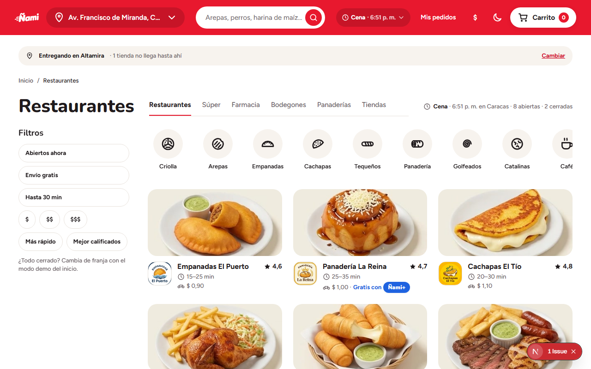
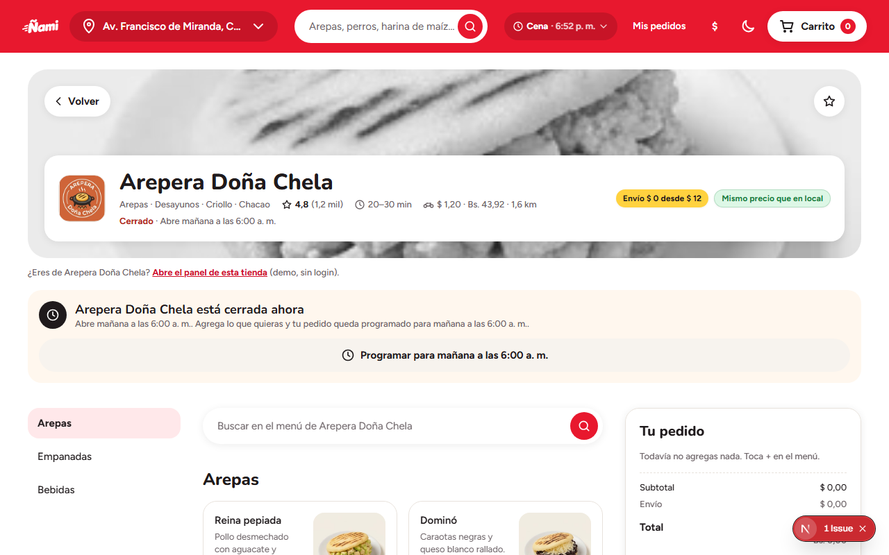
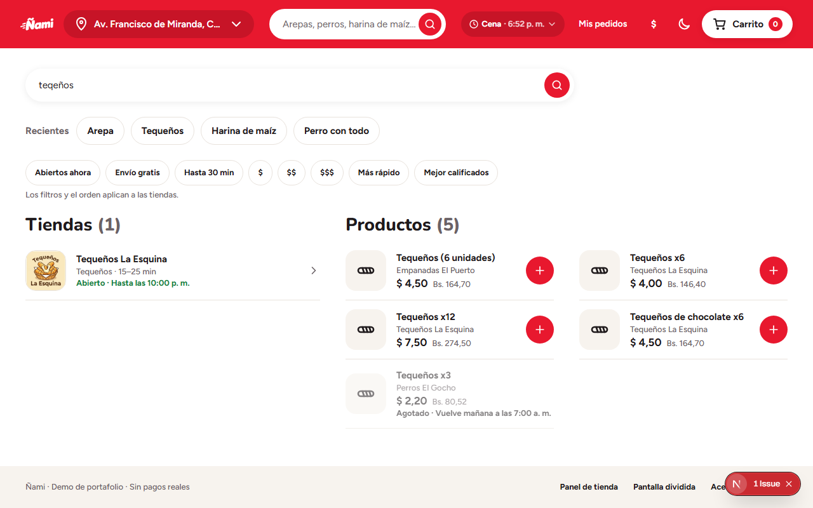
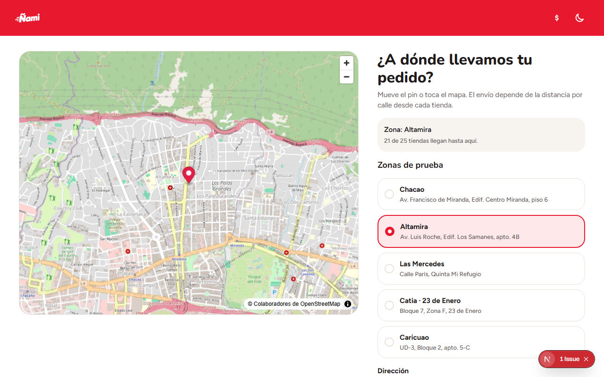
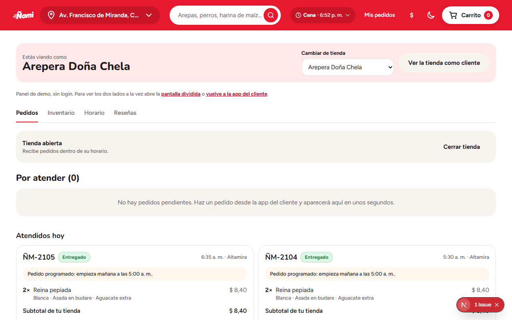
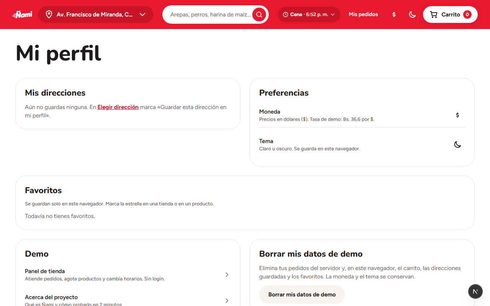
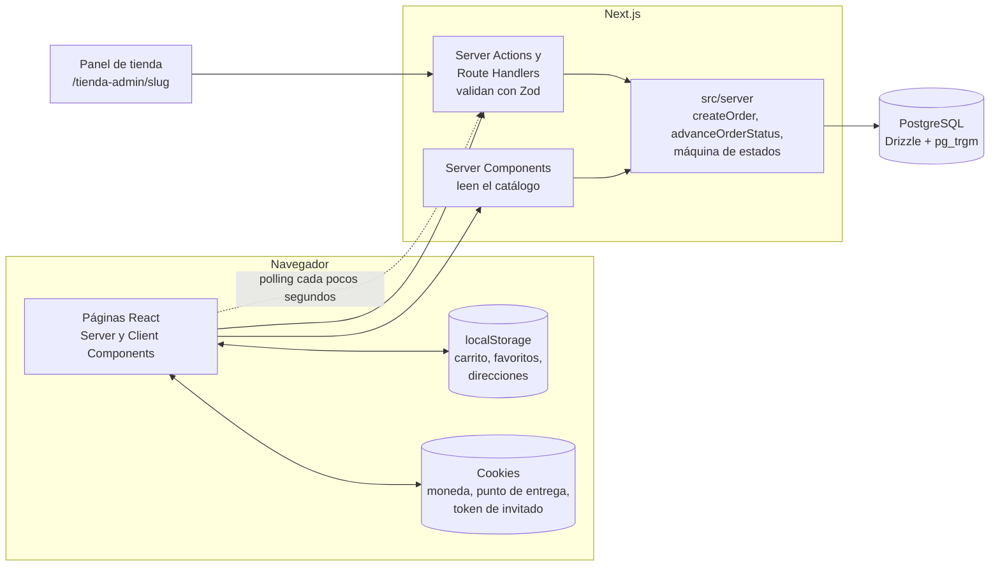

# Ñami

[](https://github.com/csswoman/nami/actions/workflows/ci.yml)

**Demo en vivo: [nami-taupe.vercel.app](https://nami-taupe.vercel.app)** · [Demo cliente + tienda + repartidor](https://nami-taupe.vercel.app/demo) · [Documentación de la API](https://nami-taupe.vercel.app/api/docs) · [Read in English](README.md)

App de delivery venezolana (comida, mercado, farmacia y tiendas). Proyecto de portafolio: el pedido, el pago y el seguimiento son simulados, y nada se cobra ni se entrega.

Next.js (App Router) · React · TypeScript · PostgreSQL · Drizzle · Zod · Zustand · MapLibre GL · Tailwind CSS · Vitest · Playwright · axe-core · Lighthouse CI · GitHub Actions.


¿Poco tiempo? Empieza el **recorrido guiado** desde el inicio o `/acerca`: te lleva por la app y explica qué hace el servidor en cada paso. Activa **«Bajo el capó»** (o agrega `?capo=1` a cualquier URL) para ver cada llamada a la API, su estado, tiempo y `requestId`, y lo que recalculó el servidor.

## Capturas
| Inicio y listado con filtros | Tienda | Búsqueda con errores de tipeo |
| --- | --- | --- |
|  |  |  |

| Dirección en el mapa | Panel de tienda | Perfil |
| --- | --- | --- |
|  |  |  |

## Arquitectura

Las páginas leen datos en el servidor y las mutaciones pasan por Server Actions o Route Handlers que solo validan (Zod) y llaman a `src/server`, donde vive la lógica. Lo que crea un visitante (carrito, favoritos, direcciones) se queda en su navegador; los pedidos del catálogo de la app van a la BD con un token de invitado.

## Decisiones importantes
- **Dinero en centavos.** Todos los montos son enteros (`integer`). Así no hay errores de redondeo con decimales flotantes y los totales se pueden comparar con `===`. La conversión a Bs. se hace solo al mostrar.
- **Tasa guardada en cada pedido.** El pedido guarda la tasa Bs./$ y el total en bolívares con que se creó. Si la tasa cambia después, el historial no cambia.
- **Recálculo en el servidor.** El carrito vive en el navegador, pero al pedir el servidor vuelve a calcular precios, envío, cupones y totales dentro de una transacción. Nunca confía en un monto que venga del cliente.
- **Un pedido con varias paradas.** `orders` + `order_stops`: el seguimiento es uno solo y cada tienda ve y avanza solo su parte con una máquina de estados (una transición inválida devuelve 409).
- **Productos con slug.** El carrito guardado en el navegador referencia productos por slug, así sigue sirviendo cuando el seed recrea los uuid.
- **Polling y no websockets.** El estado de un pedido cambia cada varios segundos y lo consultan pocos clientes. Un `fetch` periódico es suficiente, funciona igual en Vercel (sin conexiones largas) y es mucho más simple de operar y probar. La posición del repartidor se calcula en el cliente sobre una ruta precalculada, así que no hay tráfico por cada movimiento.
- **Sin servicios externos al pedir.** Las rutas por calle (OSRM) se calculan una vez en el seed; los tiles del mapa son los de OpenStreetMap.
- **Sin login.** El cliente es un invitado con cookie anónima y el panel de tienda es un modo de demo abierto, como se describe en `CLAUDE.md`.
- **Demo compartida que se repara sola.** Lo que un visitante cambie en el panel (precios, stock, horario, abierta/cerrada) vuelve solo al seed 15 minutos después del primer cambio (`src/server/demo-restore.ts`).
- **Límite de peticiones en Postgres.** 10 pedidos cada 10 minutos y 60 cambios del panel por minuto, por IP. Un solo `INSERT … ON CONFLICT DO UPDATE` atómico; responde `429` con `Retry-After` (`src/server/rate-limit.ts`).
- **Logs estructurados.** Los errores se registran como una línea de JSON con `scope` y `requestId`; `proxy.ts` devuelve el mismo id en la cabecera `x-request-id`.
- **Contrato de la API generado de Zod.** `/api/openapi.json` (OpenAPI 3.1) sale de los mismos esquemas que validan las rutas; `/api/docs` lo muestra con Swagger UI. Una prueba falla si se agrega una ruta sin documentarla.

Por qué se tomó cada decisión importante: [`docs/adr/`](docs/adr) (en inglés).

## Cómo correrlo

```bash
cp .env.example .env.development.local   # DATABASE_URL apunta al Postgres de Docker
npm install
npm run db:up        # Postgres local (Docker)
npm run db:migrate   # esquema
npm run db:seed      # tiendas, productos, horarios, rutas y tasa de demo (la primera vez pide ~325 rutas a OSRM)
npm run dev          # http://localhost:3000
```

Pruebas: `npm test` (unitarias) · `npm run test:coverage` · `npm run test:db` (integración contra un Postgres de prueba en Docker) · `npm run test:e2e` (Playwright, incluye accesibilidad con axe) · `npm run lighthouse` (después de `next build`).

En Windows, corre las pruebas desde una ruta con la unidad en mayúscula (`D:\…`, no `d:\…`): si no, Vitest carga dos copias de sí mismo y todas fallan con `Cannot read properties of undefined (reading 'config')`.

## Mapa y envío por distancia

`/direccion` muestra un mapa de OpenStreetMap (MapLibre GL, sin API key). El cliente arrastra el pin o toca el mapa, o elige una zona de prueba.

- **Zonas:** `src/lib/geo.ts` define 13 zonas de Caracas. El pin se asigna a la zona más cercana (a menos de 2,5 km de su centro; si no, queda fuera del mapa de entregas).
- **Rutas:** el seed calcula con OSRM la ruta por calle de cada tienda a cada zona y la guarda en `store_routes`. Se piden una sola vez y quedan en `src/server/db/route-cache.json`, así que `db:seed` y «Reponer catálogo» no necesitan red después. Al pedir nunca se llama a un servicio externo. Sin red se usa una estimación en línea recta (`SEED_ROUTING=estimate` la fuerza).
- **Cobertura:** cada tienda reparte hasta cierta distancia por calle (`max_delivery_m`, 7 km por defecto). Inicio, listado y búsqueda solo muestran las tiendas que llegan; la página de una tienda lejana avisa y el servidor rechaza el pedido (`OUT_OF_COVERAGE`).
- **Envío:** tarifa base de la tienda + 30 centavos por kilómetro pasados los primeros 2, redondeado a 5 centavos. Con varias tiendas en un solo motorizado vale el envío más caro más el recargo por parada extra.
- **Dónde se guarda el punto:** en la dirección del carrito y en la cookie `nami_loc`, que el servidor lee para filtrar y calcular el envío. Sin cookie se usa Altamira.

Los mapas usan los tiles públicos de OpenStreetMap, pensados para uso ligero (una demo de portafolio); para tráfico real habría que contratar un proveedor de tiles.

## Panel de tienda

El lado de la tienda, sin login: <http://localhost:3000/tienda-admin>.

- **Entrar:** elige una tienda de la lista. Arriba verás "Estás viendo como…" y un selector para cambiar de tienda. También hay un enlace en la página de cada tienda, en el pie de la app y en `/acerca`.
- **Pedidos:** la bandeja se actualiza cada 4 segundos. Cada tienda acepta o rechaza (con motivo), pasa a "en preparación" y marca "listo para retirar". Una acción que no corresponde al estado actual devuelve **409**.
- **Mercados:** el panel también sirve para mercados, farmacias y tiendas. Si al preparar un pedido falta un producto, «No hay» aplica lo que eligió el cliente (quitarlo, algo parecido o un producto concreto); el reemplazo nunca cobra más de lo pedido y los totales se recalculan.
- **Inventario:** agotar o reponer productos y cambiar precios. El cliente lo ve en su siguiente consulta y los pedidos nuevos se cobran con ese precio.
- **Horario:** turnos por día de la semana, hora de Caracas. Un día sin turnos queda cerrado y los pedidos se programan para la próxima apertura.
- **Reseñas:** lo que los clientes calificaron al recibir su pedido.
- **Ventas:** últimos 7 días (pedidos y ventas por día, ticket promedio, lo más pedido, tiempo real de preparación contra el prometido) y la **liquidación**: venta bruta, comisión de Ñami (18 % restaurantes, 12 % mercados), cupones que paga la tienda y neto a cobrar. Las reglas están en `src/lib/pricing/settlement.ts`, con pruebas.
- **Simular pedido entrante:** el servidor crea un pedido de prueba para la tienda con el mismo flujo que un cliente real, para que el panel nunca se vea vacío. Tiene su propio límite por IP. Los pedidos nuevos suenan y el título de la pestaña lleva la cuenta.
- **Abrir o cerrar** la tienda a mano (se combina con el horario).
- **Reponer catálogo:** el botón de la "Zona de demo" devuelve esa tienda a los datos del seed. Igual pasa solo 15 minutos después del primer cambio. `npm run db:cleanup` lo hace para todas, borra los pedidos de más de 7 días y los contadores viejos del límite de peticiones.

### Probarlo en 2 minutos

1. Abre <http://localhost:3000/demo>: cliente, tienda y repartidor lado a lado (en pantallas anchas; en móvil abre cada uno en su pestaña). `?repartidor=0` vuelve a las dos columnas.
2. A la izquierda pide algo de la tienda elegida. Aparece en "Por atender" en unos segundos.
3. En el centro, acepta y deja listo el pedido. A la derecha, tómalo como repartidor, recógelo y marca que llegaste: el seguimiento del cliente cambia con cada clic.
4. Cierra el panel o la app del repartidor (o espera 30 segundos sin actividad): el pedido sigue solo con el plan de tiempos, como en el modo automático.

## App del repartidor

El tercer lado del marketplace, sin login: <http://localhost:3000/repartidor>.

- Mientras la app está abierta (consulta cada 4 s), los pedidos listos **esperan al repartidor** en vez de asignarse solos. Él los toma, los recoge en la tienda y avisa que llegó; el cliente lo ve en su seguimiento.
- Solo lleva sus propios pedidos (los de su cookie de invitado; en `/demo` los tres lados la comparten) y los simulados desde el panel. Así un visitante con la app abierta no frena los pedidos de otros. Un pedido sin tomar espera como mucho 90 s.
- Con varios repartidores tomando el mismo pedido a la vez, gana exactamente uno (`SELECT … FOR UPDATE`, probado con 5 a la vez). Tomar fuera de orden, o un pedido ajeno, es un **409**.
- Si el repartidor cierra la app, el pedido sigue solo desde esa etapa.

## Cuando algo sale mal

- **La tienda no responde:** con el panel abierto, tiene 5 minutos para aceptar. Después su parte se cancela sola.
- **Una tienda rechaza su parte** de un pedido con varias tiendas: el servidor recalcula el pedido sin sus productos ni su envío (cada parada guarda su envío), mantiene propina y recargo, topa el descuento y vuelve a calcular los bolívares con la tasa guardada. El cliente lo ve en su pedido.
- **Las tiendas cancelan todo el pedido:** el cliente recibe un cupón de disculpa `PERDON-<número>` de $ 2, de un solo uso y solo para su token de invitado.
- **Lluvia u hora pico:** se elige en el reloj del modo demo (cookie `nami_demanda`). El servidor suma el recargo él mismo (el cliente nunca manda montos) y el motorizado tarda más.

Las decisiones están en [ADR 0006](docs/adr/0006-rider-app-and-marketplace-rules.md).

### Modo automático y manual

Si una tienda tiene su panel abierto (lo consultó hace menos de 30 s), los pedidos suyos esperan sus acciones durante "recibido" y "preparando". Si nadie atiende, avanzan solos por tiempo. Cada parada (`order_stops`) avanza por su cuenta con la máquina de estados de `src/lib/orders/stop-machine.ts`, y `advanceOrderStatus` decide el estado general del pedido.

## Checkout: cupones, franjas, sustituciones y cancelación
- **Cupones:** `src/lib/pricing/coupons.ts` (funciones puras). Soporta porcentaje, monto fijo, envío gratis y 2x1 por sección, con subtotal mínimo, vencimiento, tienda específica y «solo primer pedido». El servidor valida y calcula el descuento al cotizar y al crear el pedido; el cliente nunca decide cuánto se descuenta.
- **Programar entrega:** `src/lib/orders/slots.ts` ofrece franjas cada 30 minutos (hoy y mañana, hora de Caracas, mínimo 30 min de antelación) en las que todas las tiendas del pedido están abiertas.
- **Sustituciones:** al hacer el pedido el cliente elige qué hacer si falta un producto (quitarlo, algo parecido o uno concreto). Ver `src/lib/orders/substitution.ts`.
- **Cancelar:** el cliente puede cancelar con un motivo antes de que el pedido esté «En camino».
- **Reseñas:** al recibir el pedido el cliente califica cada tienda y la tienda ve las reseñas en su panel.
## Perfil, favoritos y búsqueda
- **`/perfil`:** direcciones guardadas (con su pin; se usan con un clic), moneda, tema, favoritos, enlace al panel de tienda y «Borrar mis datos de demo» (borra tus pedidos en el servidor y lo guardado en el navegador).
- **Favoritos:** la estrella en tiendas, mercados y productos. Se guardan en `localStorage` (`nami-profile`), nunca en la BD.
- **Búsqueda tolerante:** `searchCatalog` combina `unaccent` + `ILIKE` con `word_similarity` de `pg_trgm` (umbral 0,5, solo con 4 letras o más). «teqeños» encuentra «tequeños» y las coincidencias exactas salen primero.
- **Filtros y orden** (listado y búsqueda; viven en la URL): abierto ahora, envío gratis, hasta 30 min, precio ($ hasta 3,00 · $$ hasta 4,50 · $$$ más, según el promedio de sus productos) y orden por rapidez o calificación. La lógica pura está en `src/lib/listing.ts`.

## Pruebas y CI
`.github/workflows/ci.yml` corre en cada push y pull request:
1. **Calidad:** `npm run lint`, `npx next typegen` + `tsc --noEmit` y `npm run test:coverage` (unitarias con umbrales de cobertura; el resumen sale en la página del run).
2. **Integración:** Postgres 17 como servicio, migraciones, seed y `vitest.db.config.mts` (`tests/db`), con pruebas de concurrencia (dos pestañas aceptan el mismo pedido, ráfagas contra el límite de peticiones, reposición simultánea del catálogo).
3. **Playwright:** Postgres, migraciones, seed (las rutas salen de `route-cache.json`) y `playwright test`, incluida accesibilidad con axe-core (WCAG 2.1 AA, tema claro y oscuro).
4. **Lighthouse:** build de producción; accesibilidad y buenas prácticas bloquean, rendimiento y SEO avisan (`lighthouserc.json`).

## Deploy (Vercel + Neon)
El seed y el cron de limpieza en producción los corre el dueño del proyecto, no se ejecutan solos.
1. Crea el proyecto en Neon y copia la cadena de conexión *pooled* a `DATABASE_URL` (Vercel) y la directa a `MIGRATE_DATABASE_URL` (para migrar).
2. Migraciones desde tu máquina: `MIGRATE_DATABASE_URL=<directa> npm run db:migrate`.
3. Seed: `SEED_ALLOW_REMOTE=1 DATABASE_URL=<directa> npm run db:seed`.
4. Limpieza periódica (pedidos de más de 7 días, contadores del límite de peticiones y catálogo al seed): `CLEANUP_ALLOW_REMOTE=1 DATABASE_URL=<directa> npm run db:cleanup`.
5. Importa el repositorio en Vercel. Variables opcionales: `NEXT_PUBLIC_REPO_URL` y `NEXT_PUBLIC_PORTFOLIO_URL` (enlaces de `/acerca`).

## Más

Convenciones y arquitectura: `CLAUDE.md`. Plan de trabajo: `docs/PLAN.md`.
