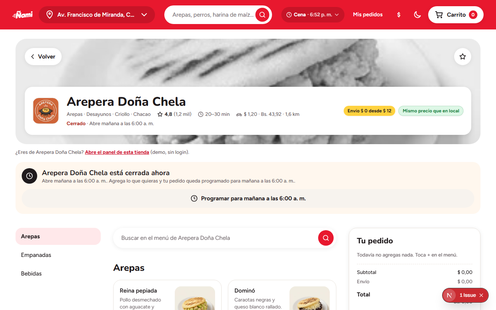
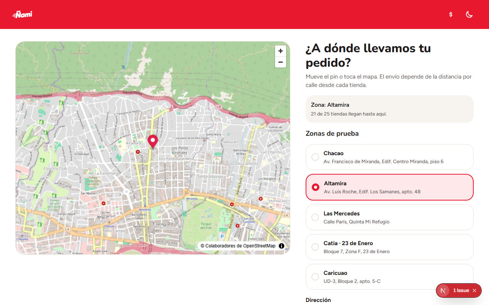
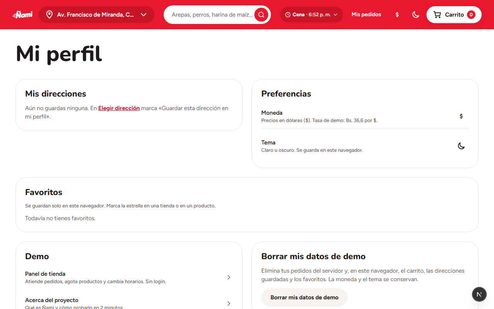
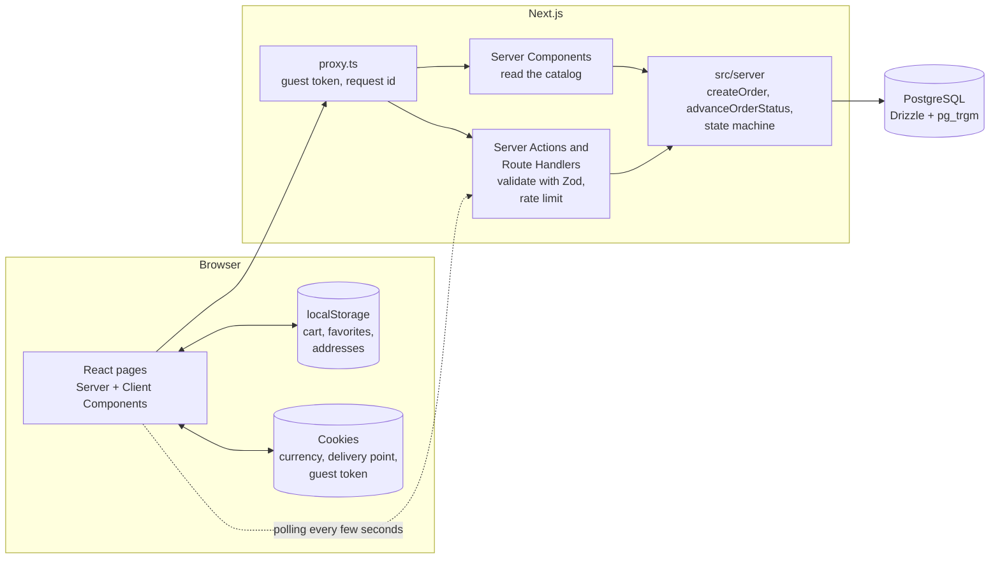

# Ñami

[](https://github.com/csswoman/nami/actions/workflows/ci.yml)

**Live demo: [nami-taupe.vercel.app](https://nami-taupe.vercel.app)** · [Try the two-sided demo](https://nami-taupe.vercel.app/demo) · [API docs](https://nami-taupe.vercel.app/api/docs) · [Leer en español](README.es.md)

A Venezuelan food and grocery delivery app (restaurants, markets, pharmacies and shops), built end to end by one developer: design system, frontend, backend and database. Checkout, payment and the courier are simulated, so you can place an order and follow it without signing up. Nothing is charged or delivered.

Next.js (App Router) · React 19 · TypeScript (strict) · PostgreSQL · Drizzle · Zod · Zustand · MapLibre GL · Tailwind CSS v4 · Vitest · Playwright · axe-core · Lighthouse CI · GitHub Actions · Vercel + Neon

## Try it in 2 minutes

1. Open **[/demo](https://nami-taupe.vercel.app/demo)**: the customer app on the left, the store's admin panel on the right (on a phone, open both in separate tabs).
2. On the left, order something from the selected store. It shows up under "Por atender" in a few seconds.
3. On the right, accept the order and move it forward: the customer's tracking screen updates stage by stage.
4. Close the panel (or wait 30 s): the order keeps going on its own, as if the store were on autopilot.

The store panel is an open, shared demo, so other visitors see your changes. Prices, stock, hours and open/closed state go back to the demo data on their own 15 minutes after the first change.

## Screenshots

| Home and filters | Store | Typo-tolerant search |
| --- | --- | --- |
|  |  |  |

| Address on the map | Store panel | Profile |
| --- | --- | --- |
|  |  |  |

## What's worth looking at

- **The server never trusts the client's money.** The cart lives in the browser, but at checkout the server recomputes prices, delivery fees, coupons and totals inside a transaction. A test sends `totalCents: 1` and checks that the stored order still has the real total. All amounts are integer cents. Each order stores the Bs./$ rate it was placed with.
- **One order, several stores, one state machine per stop.** `orders` + `order_stops`: each store accepts, prepares and hands over only its own part. An invalid transition is a `409`. A concurrency test has five panel tabs accept the same order at once: exactly one wins.
- **Thin handlers, pure domain logic.** Server Actions and Route Handlers only validate with Zod, call a service in `src/server/` and respond. Pricing, coupons, delivery slots and substitutions are pure functions in `src/lib/`, so they also run in the browser for content that never reaches the DB.
- **Public-demo hardening.** Per-IP rate limiting in Postgres (an atomic `INSERT … ON CONFLICT`, tested with 25 concurrent requests where exactly 10 get through), `429` with `Retry-After`. Self-healing shared catalog. Structured JSON error logs with a request id that is also returned to the browser.
- **API contract generated from the validators.** [`/api/docs`](https://nami-taupe.vercel.app/api/docs) is Swagger UI over an OpenAPI 3.1 spec built from the same Zod schemas the routes use. A unit test fails if a Route Handler is added without being documented.
- **Accessibility checked in CI.** axe-core (WCAG 2.1 AA) runs on the main screens in light and dark mode, and Lighthouse runs against the production build. Accessibility and best practices block the build; performance and SEO only warn.
- **Maps without paid APIs.** Street routes from every store to every delivery zone are computed once with OSRM and stored. The courier's position is interpolated on the client along that route, so tracking needs no external calls.

## Architecture



The reasoning behind the main decisions is in [`docs/adr/`](docs/adr):

| ADR | Decision |
| --- | --- |
| [0001](docs/adr/0001-polling-instead-of-websockets.md) | Polling instead of WebSockets for order tracking |
| [0002](docs/adr/0002-guest-checkout-without-accounts.md) | Guest checkout with an anonymous cookie, no accounts |
| [0003](docs/adr/0003-precomputed-routes.md) | Precomputed street routes and a client-side courier |
| [0004](docs/adr/0004-shared-demo-panel.md) | Shared store panel that restores itself |
| [0005](docs/adr/0005-rate-limiting-in-postgres.md) | Rate limiting in Postgres instead of Redis |

## Tests and CI

| Layer | What | Where |
| --- | --- | --- |
| Unit | Pricing, coupons, slots, state machine, substitutions, OpenAPI coverage of every route | `src/**/*.test.ts` (Vitest, coverage thresholds) |
| Integration | Services against a real Postgres (no ORM mocks), including concurrency and rate limiting | `tests/db` |
| End to end | Order → tracking → delivery, map, profile, filters, accessibility (axe, light and dark) | `tests/e2e` (Playwright) |
| Lighthouse | Home, listing and store page on the production build | `lighthouserc.json` |

`.github/workflows/ci.yml` runs four jobs on every push and pull request: lint + types + unit tests with coverage, integration against Postgres 17, Playwright, and Lighthouse.

## Running it locally

```bash
cp .env.example .env.development.local   # DATABASE_URL points to the Docker Postgres
npm install
npm run db:up        # local Postgres (Docker)
npm run db:migrate
npm run db:seed      # stores, products, hours, routes and a demo exchange rate
npm run dev          # http://localhost:3000
```

Tests: `npm test` · `npm run test:coverage` · `npm run test:db` (integration, starts its own Postgres in Docker) · `npm run test:e2e` · `npm run lighthouse` (after `next build`).

On Windows, run the tests from a path with an uppercase drive letter (`D:\…`, not `d:\…`). Otherwise Vitest loads two copies of itself and every suite fails with `Cannot read properties of undefined (reading 'config')`.

## With more time

- **Server-Sent Events for tracking**, if the number of concurrent viewers grew. Polling is the right call at this scale (see ADR 0001).
- **Per-visitor sandbox for the store panel.** Today the panel is shared and restores itself. A real sandbox would put each visitor's catalog changes in an overlay keyed by their guest token.
- **Real accounts and payments** (order history, saved cards, Pago Móvil confirmation). They were left out on purpose, so a recruiter can try the whole flow without signing up.
- **Error tracking** (Sentry or similar) on top of the structured logs.
- **Visual regression tests** for the design system components.

## Deploy (Vercel + Neon)

Production seeding and cleanup are run by hand by the project owner.

1. Create the Neon project. Set the *pooled* connection string as `DATABASE_URL` in Vercel and keep the direct one for migrations.
2. Migrate: `MIGRATE_DATABASE_URL=<direct> npm run db:migrate`.
3. Seed: `SEED_ALLOW_REMOTE=1 DATABASE_URL=<direct> npm run db:seed`.
4. Cleanup (orders older than 7 days, old rate-limit counters, catalog back to the seed): `CLEANUP_ALLOW_REMOTE=1 DATABASE_URL=<direct> npm run db:cleanup`.
5. Import the repo into Vercel. Optional: `NEXT_PUBLIC_REPO_URL`, `NEXT_PUBLIC_PORTFOLIO_URL` (links on `/acerca`).

Conventions and architecture rules: [`CLAUDE.md`](CLAUDE.md) (in Spanish). Work plan: [`docs/PLAN.md`](docs/PLAN.md).
